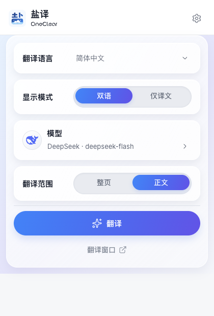
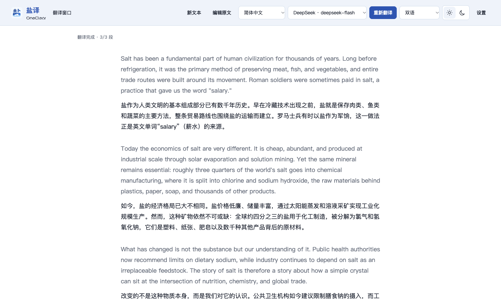
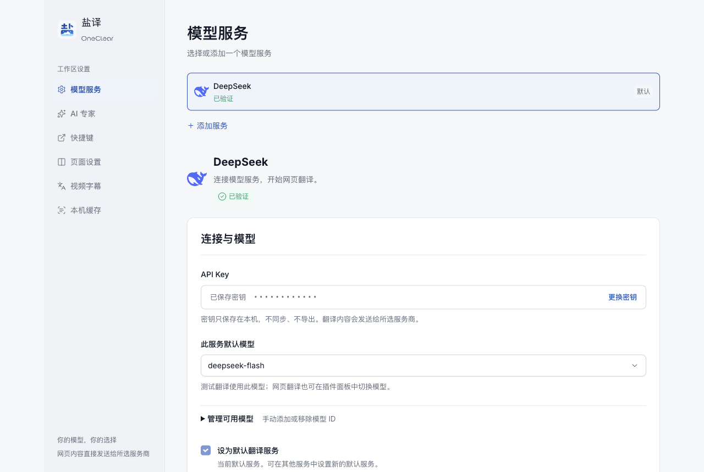
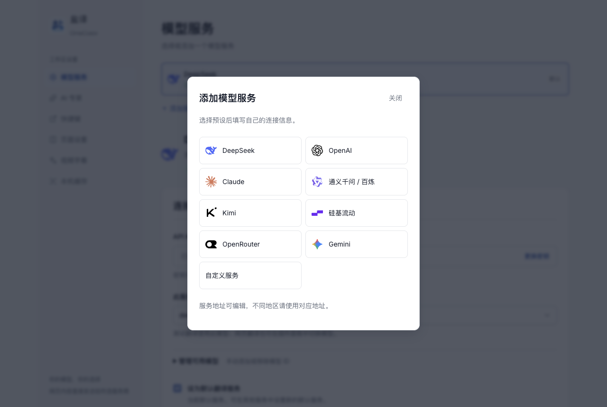
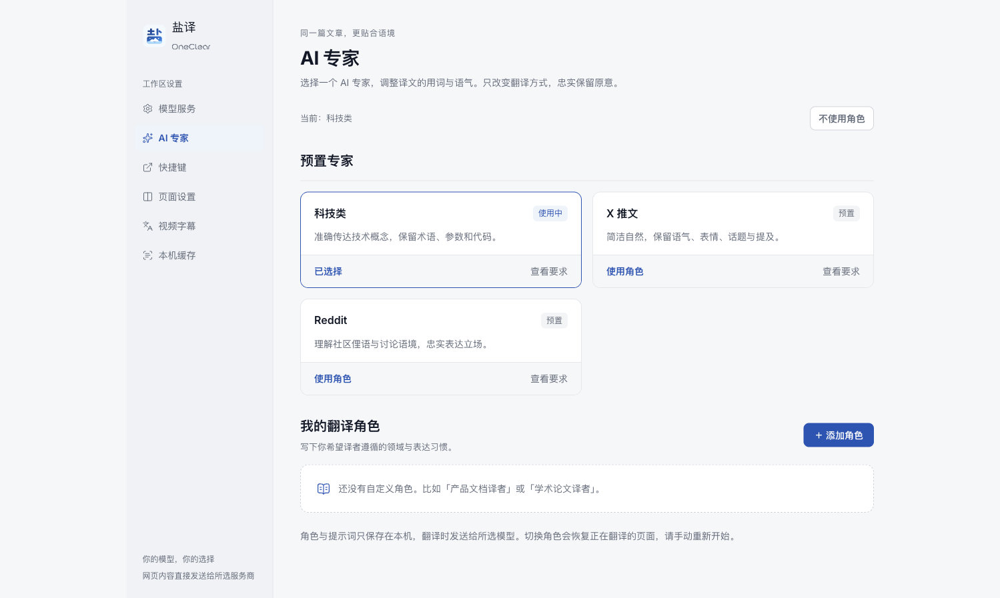
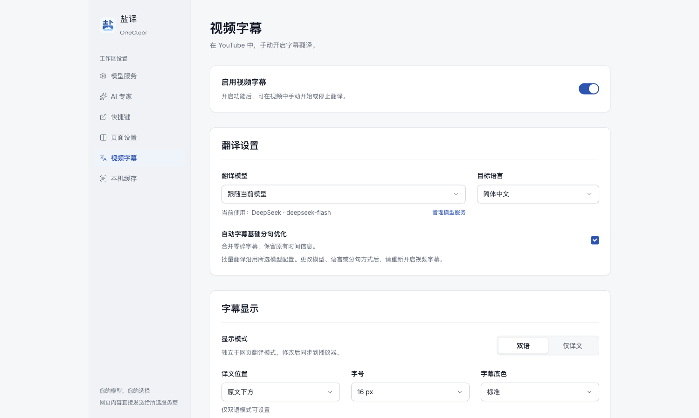
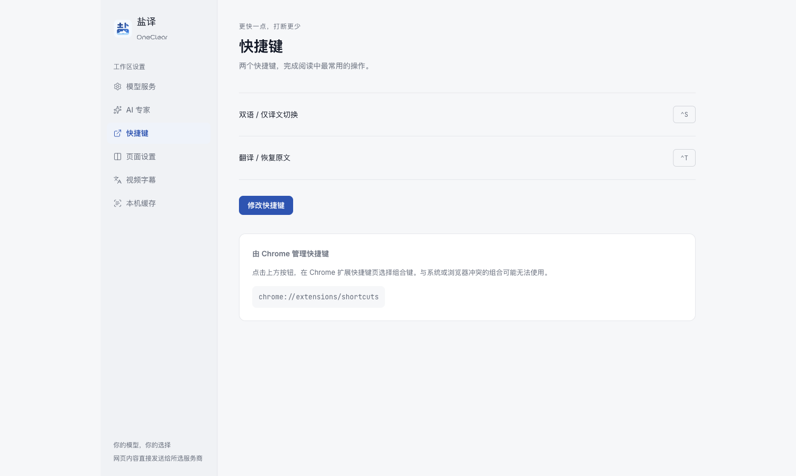
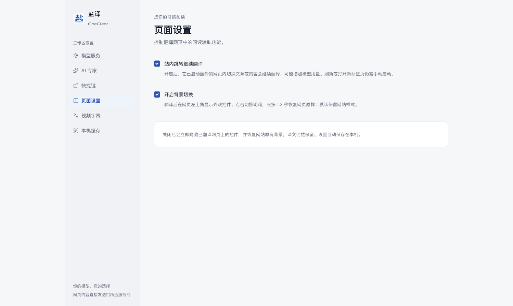
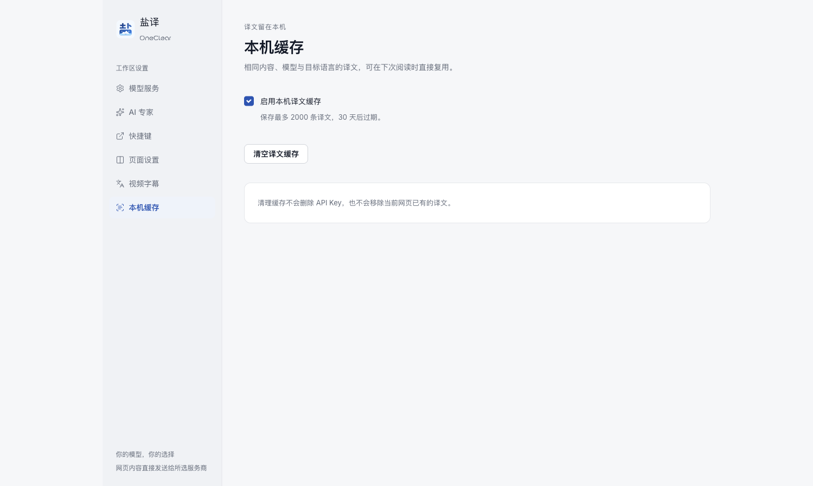

# 盐译 Oneclear

> 提炼语言的精华，让阅读更清晰。

盐译是一款 Chrome 网页翻译扩展（Manifest V3）。它不内置任何翻译服务，而是直接调用**你自己的模型服务**——OpenAI 兼容接口、Claude 或 Gemini 协议均可接入。API Key 只保存在本机浏览器存储中，请求从浏览器直达服务商，不经过任何中间服务器。

当前版本：**0.8.1**（YouTube 字幕预览版）

---

## 界面

<p align="center">
  
</p>

<p align="center"><sub>工具栏弹窗：翻译语言、显示模式、模型、翻译范围</sub></p>



<p align="center"><sub>翻译窗口：左侧原文、右侧译文，真实 DeepSeek 翻译结果</sub></p>

### 设置页

| 模型服务 | 添加模型服务 |
|---|---|
|  |  |

| AI 专家 | 视频字幕 |
|---|---|
|  |  |

| 快捷键 | 页面设置 | 本机缓存 |
|---|---|---|
|  |  |  |

---

## 功能

### 网页翻译

- **双语对照 / 仅译文 / 恢复原文** 三种显示状态，随时一键切换
- **翻译范围**可选「整页」或「正文」，正文模式自动跳过导航、侧栏、页脚等噪声区域
- **即时翻译**：当前视口优先翻译，滚动时继续处理剩余内容
- **失败段落重试**：网络中断或模型拒绝时可单独重试，无需整页重来
- **站内续译**：同一站点翻页后自动继续翻译（可在设置中关闭）
- 原文与译文均保留页面原有结构、链接、代码块和格式

### 模型服务

- 内置 9 个服务商预设，填入 API Key 即可使用；也支持任意 OpenAI 兼容服务
- 每个服务可配置多个模型 ID，在弹窗中随时切换
- 保存前会实际发起一次连接测试，验证地址、密钥和模型是否可用
- 支持结构化输出（JSON Schema）与自动降级：服务商不支持时自动回退到兼容模式

| 服务商 | 协议 | 默认地址 |
|---|---|---|
| DeepSeek | OpenAI | `https://api.deepseek.com` |
| OpenAI | OpenAI | `https://api.openai.com/v1` |
| Claude | Anthropic | `https://api.anthropic.com/v1` |
| 通义千问 / 百炼 | OpenAI | `https://dashscope.aliyuncs.com/compatible-mode/v1` |
| Kimi | OpenAI | `https://api.moonshot.cn/v1` |
| 硅基流动 | OpenAI | `https://api.siliconflow.cn/v1` |
| OpenRouter | OpenAI | `https://openrouter.ai/api/v1` |
| Gemini | Gemini | `https://generativelanguage.googleapis.com/v1beta` |
| 自定义服务 | 三者皆可 | 自行填写 |

### AI 专家

为不同场景选择不同的翻译风格，也可以自建角色：

- **科技类** — 准确传达工程、计算与科学概念，保留术语、参数和代码
- **X 推文** — 简洁自然，保留语气、表情、话题与提及
- **Reddit** — 理解社区俚语与讨论语境，忠实表达立场

每个角色的提示词都可以在设置中查看和修改。

### 翻译窗口

独立的阅读器页面，用于翻译长文、论文或任意粘贴的文本：

- 左侧原文、右侧译文，支持双语 / 仅译文切换
- 长文本自动分段，支持暂停与继续
- 浅色 / 深色主题
- 单次输入上限 50 万字符

### YouTube 字幕翻译（测试功能）

- 在设置 → 视频字幕中启用后，有字幕的视频会出现翻译入口
- 支持双语字幕与仅译文模式
- 需要访问 YouTube 的权限

### 其他

- **译文缓存**：相同内容命中缓存时不再重复请求，可在设置中一键清空（不会删除密钥）
- **快捷键**：`Alt+T` 翻译 / 恢复原文，`Alt+B` 双语 / 仅译文切换，均可自定义

---

## 安装

本仓库只包含构建产物，不需要 Node.js 或任何构建步骤。

1. 下载仓库（`git clone` 或右上角 Code → Download ZIP 后解压）
2. Chrome 地址栏打开 `chrome://extensions`，右上角开启「**开发者模式**」
3. 点击「**加载已解压的扩展程序**」，选择本仓库的 `dist/` 文件夹
4. 在工具栏固定盐译，点击图标 →「添加模型服务」

要求 Chrome 120 及以上。

### 更新并保留配置

1. 拉取最新代码到原来加载的那个文件夹
2. 在 `chrome://extensions` 点击盐译的「重新加载」
3. 刷新已打开的网页

不要先卸载旧扩展——使用原路径更新才能保留本机配置。

---

## 使用

### 首次配置

1. 点击工具栏的盐译图标
2. 选择服务商预设，或选择「自定义服务」
3. 填写 **API Key**、**服务地址**（预设已自动填好）和**模型 ID**（如 `deepseek-chat`）
4. 点击「测试翻译」，验证通过后保存

Chrome 会请求访问该模型地址的权限，这是发送翻译请求所必需的。

### 翻译网页

在任意网页点击图标或按 `Alt+T` 开始翻译。弹窗中可调整：

- **翻译语言** — 目标语言
- **显示模式** — 双语 / 仅译文
- **模型** — 已配置的模型
- **翻译范围** — 整页 / 正文

再次按 `Alt+T` 恢复原文。

---

## 权限说明

| 权限 | 用途 |
|---|---|
| `activeTab` | 在当前标签页注入翻译脚本，仅在点击图标或按快捷键后触发 |
| `scripting` | 注入翻译逻辑、读取页面文本 |
| `storage` | 在本机保存模型配置、密钥、译文缓存 |
| 可选主机权限 `https://*/*` | 仅在保存模型服务时按地址域名单独申请 |
| 主机权限 `https://www.youtube.com/*` | YouTube 字幕翻译 |

扩展没有常驻后台请求，不会读取浏览历史，不会向开发者上报任何数据。

---

## 隐私

- API Key 保存在 `chrome.storage.local`，仅本机可读，不会上传
- 翻译请求从浏览器直接发往你选择的服务商，不经过第三方中转
- 译文缓存在本机，可在设置 → 本机缓存中随时清空
- 本仓库不包含任何密钥、浏览记录或缓存数据

---

## 目录结构

```
dist/
├── manifest.json          # MV3 清单
├── background.js          # Service Worker：设置、密钥、请求与缓存
├── content.js             # 网页翻译内容脚本
├── youtube-content.js     # YouTube 字幕翻译
├── popup.html             # 工具栏弹窗
├── options.html           # 设置页（模型服务 / AI 专家 / 快捷键 / 页面设置 / 视频字幕 / 本机缓存）
├── reader.html            # 翻译窗口
├── assets/                # 打包的 JS、CSS、字体、图标、服务商 Logo
├── licenses/              # 字体许可全文
└── INSTALL.txt            # 安装与更新说明

docs/screenshots/          # README 界面截图（实际运行截取）
```

---

## 第三方资源

- 模型 Logo：[Lobe Icons](https://github.com/lobehub/lobe-icons)，见 `LOBE-ICONS-LICENSE.txt`
- 界面图标：[Lucide](https://lucide.dev)（ISC）与 [Phosphor Icons](https://github.com/phosphor-icons/core)，见 `PHOSPHOR-LICENSE.txt`
- 字体：Inter Variable、JetBrains Mono（SIL OFL），本地打包，无运行时 CDN 请求

模型与服务商名称、Logo 仅用于识别用户所连接的服务，不表示品牌授权或合作。详见 `dist/THIRD-PARTY-NOTICES.txt`。

---

## 已知限制

- YouTube 字幕翻译仍为测试功能，仅对提供字幕的视频生效
- 单次翻译文本上限 50 万字符，超长文档请使用翻译窗口分段处理
- 部分服务商不支持 JSON Schema 结构化输出，扩展会自动降级，此时翻译质量可能略有差异
- 仅支持 Chrome 120+ 及同内核浏览器（Edge、Arc 等）
